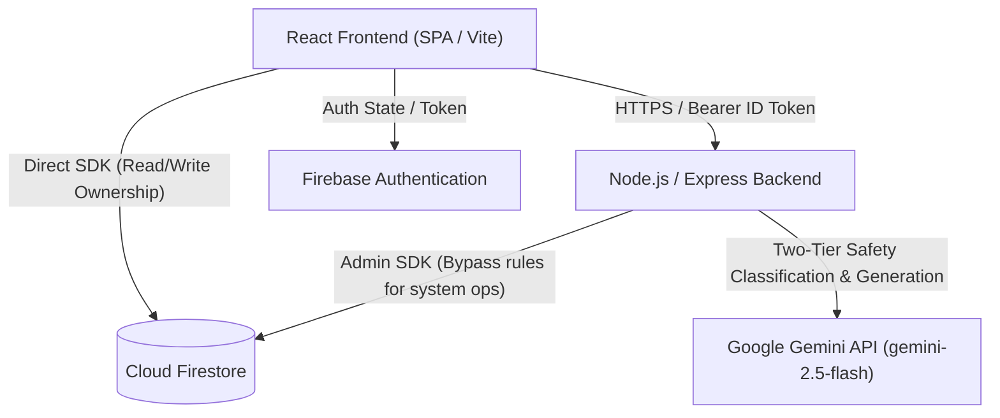
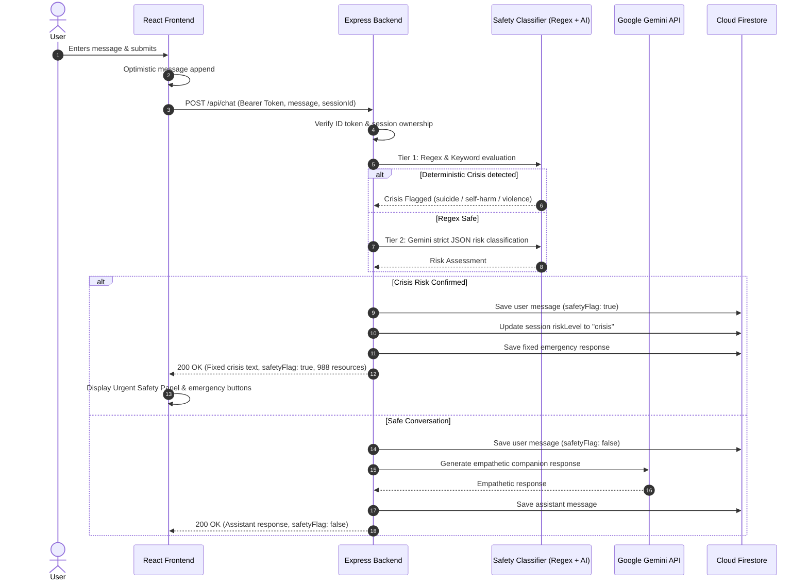
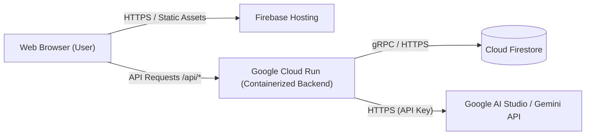

# Architecture & System Design

## 1. High-Level Architecture Diagram



---

## 2. Request & Safety Lifecycle Flow



---

## 3. Firestore Data Model & Access Boundaries

### Collection: `users/{userId}`
- **Permissions:** Owner only (`request.auth.uid == userId`).
```typescript
interface UserDoc {
  uid: string;
  email: string | null;
  isAnonymous: boolean;
  createdAt: Timestamp;
}
```

### Collection: `sessions/{sessionId}`
- **Permissions:** Owner only. Client cannot modify `uid`, `createdAt`, or inject server-controlled `riskLevel`.
```typescript
interface SessionDoc {
  uid: string;
  title: string;
  status: "active" | "ended";
  riskLevel: "none" | "elevated" | "crisis";
  endedAt: Timestamp | null;
  createdAt: Timestamp;
  updatedAt: Timestamp;
  messageCount: number;
}
```

### Subcollection: `sessions/{sessionId}/messages/{messageId}`
- **Permissions:** Owner only. Client cannot write `safetyFlag: true` or `crisisType`.
```typescript
interface MessageDoc {
  role: "user" | "assistant";
  text: string;
  safetyFlag: boolean;
  crisisType: string | null;
  createdAt: Timestamp;
}
```

### Subcollection: `sessions/{sessionId}/summary/latest`
- **Permissions:** Client read-only. Client write denied (`allow write: if false`). Only written by server via Firebase Admin SDK.
```typescript
interface SessionSummaryDoc {
  overview: string;
  emotionalThemes: string[];
  strengths: string[];
  copingSteps: string[];
  followUp: string;
  riskNote: string;
  generatedAt: Timestamp;
}
```

---

## 4. Deployment Topology


